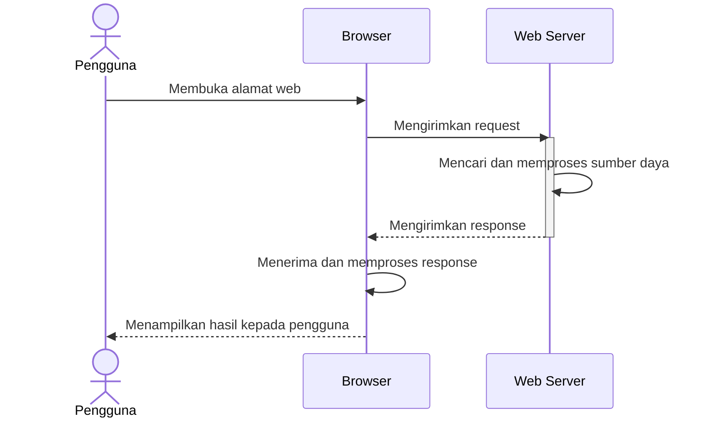
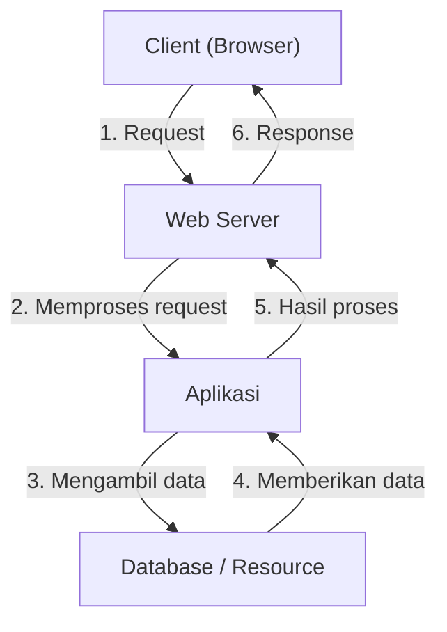

# 📘 BAB 2 — CARA KERJA APLIKASI WEB

Pada bab sebelumnya, kita telah menyiapkan lingkungan pengembangan menggunakan Laravel Herd. Sebelum mulai membuat aplikasi Laravel, kita perlu memahami terlebih dahulu bagaimana aplikasi web bekerja secara umum.

Pemahaman ini penting karena setiap aplikasi Laravel pada dasarnya tetap bekerja menggunakan mekanisme aplikasi web: menerima request, memprosesnya, lalu mengirimkan response.

---

## 2.1 Tujuan Pembelajaran

Setelah mempelajari bab ini, Anda diharapkan mampu:

- menjelaskan pengertian aplikasi web;
- membedakan client dan server;
- menjelaskan pengertian request dan response;
- mengenali fungsi web server;
- menjelaskan proses ketika pengguna membuka sebuah halaman web;
- membedakan konten statis dan konten dinamis.

---

## 2.2 Apa Itu Aplikasi Web?

Aplikasi web adalah program yang dapat digunakan melalui browser, seperti Google Chrome, Microsoft Edge, atau Mozilla Firefox.

Berbeda dengan aplikasi yang harus dipasang langsung pada komputer, aplikasi web biasanya dijalankan pada server dan diakses menggunakan alamat tertentu. Pengguna cukup membuka alamat tersebut melalui browser.

Contoh aplikasi web antara lain:

- halaman sekolah;
- toko daring;
- sistem informasi akademik;
- layanan perbankan;
- media sosial;
- aplikasi pengelolaan data.

Secara umum, aplikasi web melibatkan beberapa bagian berikut:

| Bagian | Peran |
|---|---|
| Client | Perangkat atau program yang meminta layanan, biasanya browser |
| Server | Komputer yang menerima dan memproses permintaan |
| Web server | Program yang menerima request dan mengirimkan response |
| Aplikasi | Program yang menjalankan aturan dan fungsi tertentu |
| Database | Tempat menyimpan data aplikasi |
| Jaringan | Penghubung antara client dan server |

Pada aplikasi sederhana, beberapa bagian tersebut dapat berjalan pada satu komputer. Pada aplikasi yang lebih besar, setiap bagian dapat berjalan pada komputer atau server yang berbeda.

---

## 2.3 Client dan Server

### Client

Client adalah pihak yang meminta layanan dari server. Dalam aplikasi web, client biasanya berupa browser yang berjalan pada komputer atau telepon pintar pengguna.

Contohnya, ketika Anda mengetik alamat berikut pada browser:

```text
https://www.example.com
```

browser bertindak sebagai client yang meminta halaman dari server.

### Server

Server adalah komputer yang menyediakan layanan atau sumber daya kepada client. Server dapat menerima permintaan, menjalankan program, membaca database, lalu mengirimkan hasilnya kembali.

Server tidak selalu berarti satu komputer khusus. Istilah server juga dapat merujuk pada program yang menjalankan layanan tertentu. Dalam pembahasan ini, web server adalah program yang menangani komunikasi antara browser dan aplikasi web.

### Analogi Sederhana

Hubungan client dan server dapat dianalogikan seperti pelanggan dan restoran:

| Restoran | Aplikasi Web |
|---|---|
| Pelanggan | Client atau pengguna |
| Pesanan | Request |
| Dapur dan petugas | Server serta aplikasi |
| Makanan | Response |

Pelanggan menyampaikan pesanan, restoran memproses pesanan tersebut, kemudian memberikan hasilnya kepada pelanggan.

---

## 2.4 Request

Request adalah permintaan yang dikirimkan oleh client kepada server. Ketika pengguna membuka halaman, mengirim formulir, atau menekan tombol tertentu, browser mengirimkan request.

Request biasanya memiliki beberapa informasi penting:

- alamat tujuan atau URL;
- metode HTTP;
- header;
- data yang dikirimkan, jika ada.

### URL

URL adalah alamat yang digunakan untuk mengakses sumber daya pada web. Contohnya:

```text
https://www.example.com/produk
```

Bagian-bagian sederhananya adalah:

| Bagian | Contoh | Keterangan |
|---|---|---|
| Protokol | `https` | Aturan komunikasi yang digunakan |
| Nama domain | `www.example.com` | Nama alamat server |
| Path | `/produk` | Lokasi atau tujuan yang diminta |

### Metode HTTP

Metode HTTP menunjukkan tindakan yang ingin dilakukan oleh client.

| Metode | Kegunaan Umum |
|---|---|
| `GET` | Meminta atau membaca data |
| `POST` | Mengirimkan data baru |
| `PUT` | Mengganti data yang sudah ada |
| `PATCH` | Memperbarui sebagian data |
| `DELETE` | Menghapus data |

Pada tahap awal, dua metode yang paling sering digunakan adalah `GET` dan `POST`. Membuka halaman web biasanya menggunakan `GET`, sedangkan mengirim formulir biasanya menggunakan `POST`.

Contoh sederhana request ketika pengguna membuka halaman produk:

```text
GET /produk HTTP/1.1
Host: www.example.com
```

Artinya, client meminta halaman `/produk` kepada server `www.example.com`.

Contoh tersebut merupakan gambaran sederhana dari request HTTP. Pada browser modern, komunikasi dapat menggunakan HTTP/2 atau HTTP/3, sehingga tampilan teknisnya pada Developer Tools tidak selalu persis sama dengan contoh di atas.

### Melihat Request dan Response dengan Developer Tools

Browser modern menyediakan alat pengembang untuk melihat komunikasi antara browser dan server. Salah satu bagian yang penting adalah tab **Network**.

Pada Firefox, buka menu **Web Developer Tools**, kemudian pilih tab **Network**. Developer Tools juga dapat dibuka menggunakan tombol pintas `Ctrl + Shift + E` untuk langsung membuka Network Monitor. Browser lain, seperti Google Chrome dan Microsoft Edge, juga menyediakan tab **Network** pada Developer Tools.

Setelah tab **Network** terbuka, lakukan langkah berikut:

1. Buka atau muat ulang sebuah halaman web.
2. Perhatikan daftar request yang muncul.
3. Pilih salah satu request untuk melihat URL, metode HTTP, status code, header, dan response.

Saat membuka satu halaman, browser biasanya mengirimkan beberapa request sekaligus. Selain request untuk dokumen HTML, browser dapat meminta berkas CSS, JavaScript, gambar, dan font.

Contoh request berikut:

```text
GET /produk HTTP/1.1
```

dapat ditemukan pada tab **Network** ketika browser meminta halaman `/produk`. Setelah request diproses, informasi seperti status `200 OK` dan isi response dapat dilihat pada panel detail request tersebut.

---

## 2.5 Response

Response adalah jawaban yang dikirimkan server kepada client setelah memproses request.

Response dapat berupa:

- halaman HTML;
- data dalam format JSON;
- gambar atau berkas lainnya;
- pesan kesalahan;
- pengalihan ke alamat lain.

### Status Code

Response memiliki status code yang menunjukkan hasil pemrosesan request.

| Status Code | Arti |
|---|---|
| `200 OK` | Request berhasil diproses |
| `201 Created` | Data baru berhasil dibuat |
| `301` atau `302` | Client diarahkan ke alamat lain |
| `400 Bad Request` | Request yang dikirim tidak benar |
| `401 Unauthorized` | Client belum memiliki izin yang diperlukan |
| `403 Forbidden` | Akses ditolak oleh server |
| `404 Not Found` | Sumber daya tidak ditemukan |
| `500 Internal Server Error` | Terjadi kesalahan pada server |

Contoh response sederhana:

```text
HTTP/1.1 200 OK
Content-Type: text/html

<h1>Daftar Produk</h1>
```

Status `200 OK` menunjukkan bahwa request berhasil. Setelah menerima response tersebut, browser membaca isi HTML dan menampilkannya kepada pengguna.

---

## 2.6 Bagaimana Web Server Bekerja?

Web server adalah program yang menunggu request dari client, memproses permintaan awal, lalu mengirimkan response.

Alur sederhananya adalah sebagai berikut:



### Contoh Membuka Halaman Web

Misalnya pengguna membuka alamat:

```text
https://www.example.com/about
```

Proses yang terjadi secara umum adalah:

1. Pengguna memasukkan alamat ke dalam browser.
2. Browser menemukan server yang menangani alamat tersebut.
3. Browser mengirimkan request `GET` untuk path `/about`.
4. Web server menerima request tersebut.
5. Web server menentukan sumber daya yang diminta.
6. Jika diperlukan, web server meminta bantuan aplikasi untuk menghasilkan halaman.
7. Aplikasi dapat membaca atau menyimpan data pada database.
8. Server mengirimkan response kepada browser.
9. Browser menampilkan halaman kepada pengguna.

Secara ringkas, prosesnya dapat digambarkan seperti berikut:




### Konten Statis dan Dinamis

Web server dapat mengirimkan konten statis maupun konten dinamis.

#### Konten Statis

Konten statis adalah berkas yang sudah tersedia dan dikirimkan tanpa perlu dibuat ulang berdasarkan data pengguna.

Contohnya:

- gambar;
- berkas CSS;
- berkas JavaScript;
- dokumen PDF.

#### Konten Dinamis

Konten dinamis dibuat atau diubah berdasarkan request, kondisi aplikasi, atau data yang tersimpan.

Contohnya:

- daftar produk dari database;
- informasi profil pengguna;
- hasil pencarian;
- laporan berdasarkan tanggal tertentu.

Pada konten dinamis, web server biasanya meneruskan request kepada aplikasi. Aplikasi memproses request tersebut, mengambil data yang diperlukan, lalu menghasilkan response untuk dikirimkan kepada client.

---

## Ringkasan Bab Ini

Hal-hal penting yang perlu diingat:

- Aplikasi web digunakan melalui browser.
- Client mengirimkan request kepada server.
- Server memproses request dan mengirimkan response.
- Web server bertugas menangani komunikasi antara client dan aplikasi.
- Request dapat menggunakan metode seperti `GET` dan `POST`.
- Response memiliki status code yang menunjukkan hasil pemrosesan.
- Response dapat berupa HTML, JSON, gambar, atau pesan kesalahan.
- Konten web dapat berupa konten statis atau konten dinamis.

Pada bab berikutnya, kita akan menerapkan konsep tersebut menggunakan Laravel. Kita akan membuat aplikasi sederhana dan melihat bagaimana Laravel menerima request, menentukan tujuan request, lalu menghasilkan response.
