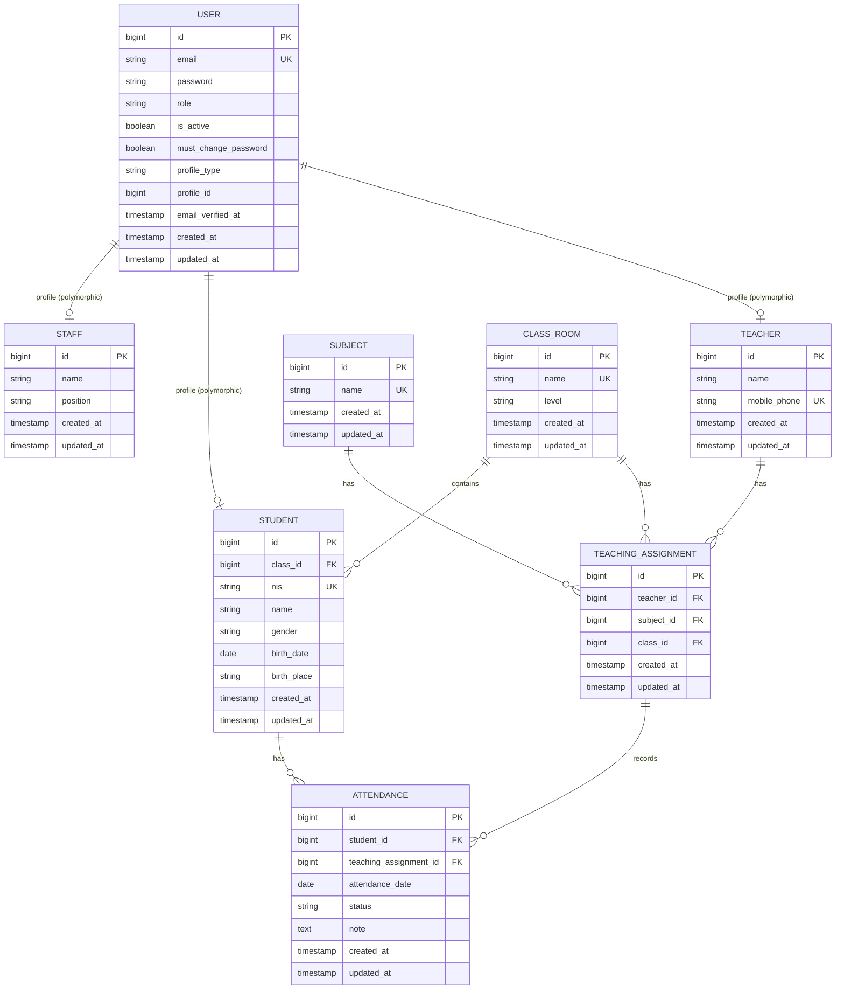

# Entity Relationship Diagram — Prezence

ERD berikut menggambarkan entitas dan relasi utama aplikasi Prezence berdasarkan PRD dan SRS.



## Catatan

- Satu `User` memiliki satu profile polymorphic: `Teacher`, `Student`, atau `Staff`.
- `profile_type` dan `profile_id` berada pada tabel `users` dan wajib diisi.
- `User` tidak memiliki field `name`. Nama disimpan pada tabel profile.
- `Staff` dapat memiliki role `admin` atau `report_viewer`.
- `report_viewer` dapat melihat laporan `Attendance` seluruh `Student`.
- Kombinasi `teacher_id`, `subject_id`, dan `class_id` pada `TeachingAssignment` harus unik.
- `class_id` pada `Student` dan `TeachingAssignment` merujuk ke tabel `class_rooms`.
- Pada versi awal, `TeachingAssignment` belum memiliki field jadwal.
- Satu `Student` dapat memiliki banyak `Attendance`.
- Satu `TeachingAssignment` dapat memiliki banyak `Attendance`.

## Status Attendance

Nilai internal `status` yang digunakan:

```text
present  → Hadir
excused  → Izin
sick     → Sakit
absent   → Alpa
```

## Aturan Attendance

Kombinasi berikut menjadi key pencarian Attendance:

```text
student_id + teaching_assignment_id + attendance_date
```

`Student` pada `Attendance` harus berasal dari `ClassRoom` yang sama dengan
`TeachingAssignment`. Jika kombinasi belum tersedia, record dibuat. Jika sudah
tersedia dan nilainya berubah, record diperbarui menggunakan `firstOrNew()` dan
`isDirty()`. Kombinasi tersebut
memiliki unique constraint pada database.
